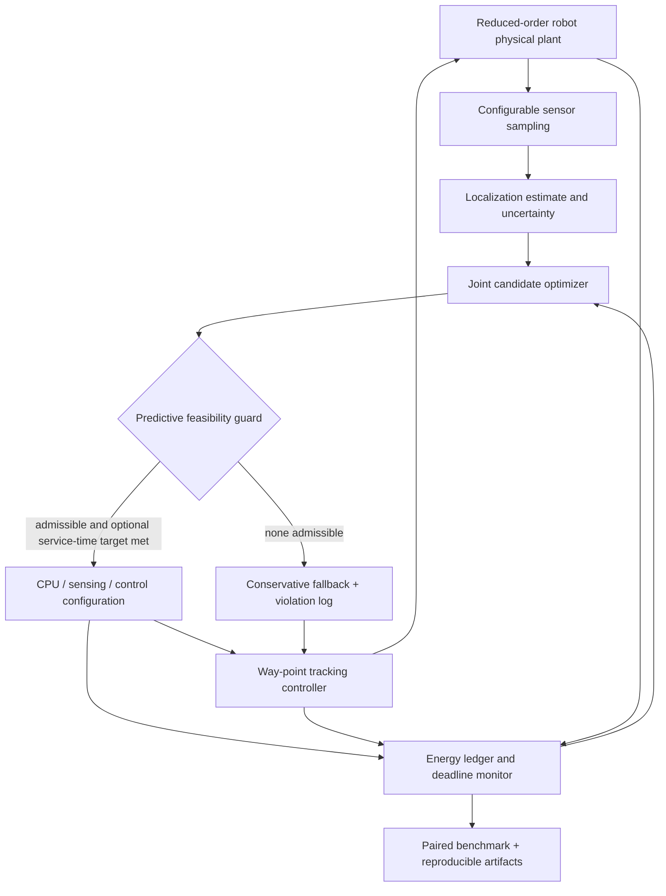

# ECO-CPS — Energy-Aware Co-Design for Autonomous Cyber-Physical Systems

**Simulation-first PhD research prototype for the joint optimization of sensing, embedded computation, and autonomous control.**

ECO-CPS studies the following question:

> Can a battery-constrained autonomous cyber-physical system coordinate sensing rates, processor operating modes, and control updates to reduce total energy while respecting deadlines, estimation quality, and control constraints?

The platform implements a deterministic differential-drive *unicycle* robot benchmark, component-level energy accounting, finite-search constraint-aware policy selection, ablations, and reproducible CSV/JSON evidence. It is an **early research baseline**, not a field-tested autonomous controller or validated physical energy meter.

## Project scope and contributions

- **Unified energy ledger:** sensing, CPU activity, communication, motion actuation, and configuration-switching energy in joules.
- **Three adaptation dimensions:** localization sensor sampling (2/5/10 Hz), processor clock proxy (80/160/240 MHz), and control period (0.1/0.2/0.4 s) with cruise-speed adaptation (0.4/0.6/0.8 m/s).
- **Joint policy:** enumerate 81 candidate configurations, reject those violating approximate feasibility checks, and minimize predicted mission energy including switching penalties.
- **Conservative fallback:** choose the fixed high-fidelity configuration if all candidates are rejected. Log fallback; **do not** claim fallback is safe or feasible when constraints cannot be met.
- **Six policies:** fixed, sensing-only, computing-only, control-only, energy-only joint adaptation, and v0.2 service-time-aware `joint_qos`.
- **Service-quality constraint (v0.2):** an optional mission-completion target separate from the hard mission deadline, with deadline-aware selection for `joint_qos` and per-run observed target attainment.
- **Matched-seed analysis (v0.2):** paired energy and mission-time differences against fixed control, completion and target-attainment counts, and deterministic exploratory percentile bootstrap intervals.
- **Reproducibility:** seeded localization noise, identical seeds across policy comparisons, complete per-run summaries, optional step traces, automated tests, and Python 3.10–3.13 CI.

The main distinction from the companion repository [`energy-aware-adaptive-autonomous-cps`](https://github.com/Hirakhyzer/energy-aware-adaptive-autonomous-cps) is the explicit **joint finite-search co-design formulation**, layered feasible-mode screening, and sensor/CPU/control ablation suite. Reuse or duplication of scientific claims is not intended.

## Architecture



## Install

Python 3.10+ recommended. There are no mandatory third-party runtime dependencies.

```bash
python -m venv .venv
source .venv/bin/activate   # Windows PowerShell: .venv\Scripts\Activate.ps1
python -m pip install -e '.[dev]'
python -m pytest -q
```

## Run

```bash
# Single deterministic mission
eco-cps simulate --config configs/baseline.json --policy joint --seed 0

# Store one run, including per-step JSON traces
eco-cps simulate --policy joint --seed 0 --out results/demo

# Run matched-seed policy comparisons
eco-cps benchmark --config configs/baseline.json --seeds 0 1 2 --out results/benchmark --traces

# Read saved aggregate metrics
eco-cps report --input results/benchmark

# v0.2: compare all six policies with a modeled 18-second service-time target
eco-cps benchmark --config configs/qos-18s.json --seeds 0 1 2 --out results/qos-18s
eco-cps report --input results/qos-18s --paired

# v0.2: directly simulate the deadline-aware policy
eco-cps simulate --config configs/qos-18s.json --policy joint_qos --seed 0

# Two-scenario experiment (nominal and heavy load), 5 seeds each
python experiments/run_all.py

# Module form also works
python -m eco_cps --help
```

## Methods

For each modeled operating mode, the objective approximates

\[
\min_{m \in \mathcal{M}}\quad \widehat{T}(m)\,\widehat{P}_{\mathrm{total}}(m)
+ \lambda_{\mathrm{switch}}\mathbf{1}[m\ne m_{\mathrm{prev}}]
\]

subject to predicted CPU timing, sensor-uncertainty, control-period, mission-deadline, and battery-reserve bounds. `joint_qos` additionally rejects candidate configurations whose predicted arrival would exceed the optional `service_time_limit_s` target. Tracking-error bounds are monitored in simulation; no formal guarantee is claimed for future trajectories. The benchmark uses synthetic parameters and a simple waypoint controller rather than measured robot dynamics.

Actual simulation energy is calculated by integrating a per-component model: `E_total = E_sensing + E_computing + E_communication + E_actuation + E_switching`. Unlike measured electricity consumption, these numbers are **model outputs**, not physical hardware observations.

## Outputs

`runs.json`, `runs.csv`, `summary.json`, and `summary.csv` include completion, energy, duration, timing violations, cross-track error, and fallback statistics. v0.2 also writes `paired.json` and `paired.csv` with matched-seed comparisons against fixed operation (when both policies are available). Paired energy and time differences are based on runs where both policies completed; all runs contribute to completion and service-target counts. Bootstrap intervals are exploratory, especially with only three seeds. Passing `--traces` also writes step-by-step state/control evidence into `traces/`. Generated results are ignored by Git to avoid accidental versioning of large experiment artifacts.

## Responsible research interpretation

- **No validated energy savings are claimed.** Lower modeled joules must be reported together with longer execution duration and any mission failures.
- This is a software-only, reduced-order simulator. Control constraints and fallback behavior are **not** hardware safety assurances.
- The optimizer uses a simplified predicted mission-time approximation; no model predictive control theorem or optimality over real trajectories is claimed.
- Before publication, calibrate sensing, computing, and actuation energy on actual hardware; measure optimizer overhead; broaden tasks, traces, and statistical comparisons; compare against related co-design methods.
- This project emphasizes **energy efficiency and real-time autonomous embedded CPS**, not cyberattack research.

See [`docs/`](docs/) for architecture, mathematical assumptions, benchmarks, reproducibility, hardware validation, and open research questions.

## Status

**v0.2 — service-time-aware energy co-design and paired comparative analysis.** The v0.1 `joint` optimizer remains available to reveal energy-versus-duration trade-offs; the v0.2 `joint_qos` optimizer is a modeled, heuristic time-target guard, **not a guaranteed real-world deadline controller**. Future work: calibrated physical power traces; adaptive planning under uncertainty; runtime constraint envelopes; more realistic sensor/controller coupling; hardware-in-the-loop studies.

## Citation and license

Use [`CITATION.cff`](CITATION.cff) for software citations. MIT license; see [`LICENSE`](LICENSE).
