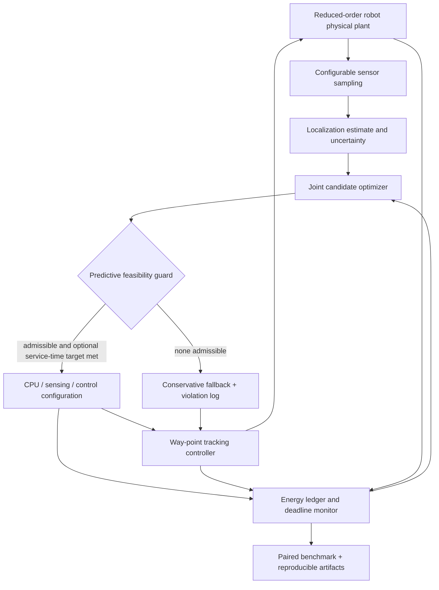

# ECO-CPS — Energy-Aware Co-Design for Autonomous Cyber-Physical Systems

**Simulation-first PhD research prototype for the joint optimization of sensing, embedded computation, and autonomous control.**

ECO-CPS studies the following question:

> Can a battery-constrained autonomous cyber-physical system coordinate sensing rates, processor operating modes, and control updates to reduce total energy while respecting deadlines, estimation quality, and control constraints?

The platform implements a seeded differential-drive *unicycle* robot benchmark, component-level energy accounting, finite-search constraint-aware policy selection, ablations, bounded uncertainty, disturbances, and reproducible CSV/JSON evidence. It is an **early research baseline**, not a field-tested autonomous controller or validated physical energy meter.

## Project scope and contributions

- **Unified energy ledger:** sensing, CPU activity, communication, motion actuation, and configuration-switching energy in joules.
- **Three adaptation dimensions:** localization sensor sampling (2/5/10 Hz), processor clock proxy (80/160/240 MHz), and control period (0.1/0.2/0.4 s) with cruise-speed adaptation (0.4/0.6/0.8 m/s).
- **Joint policy:** enumerate 81 candidate configurations, reject those violating approximate feasibility checks, and minimize predicted mission energy including switching penalties.
- **Conservative fallback:** choose the fixed high-fidelity configuration if all candidates are rejected. Log fallback; **do not** claim fallback is safe or feasible when constraints cannot be met.
- **Seven policies (v0.3):** fixed, sensing-only, computing-only, control-only, energy-only joint adaptation, v0.2 service-time-aware `joint_qos`, and v0.3 uncertainty-aware `joint_robust`.
- **Service-quality constraint (v0.2):** an optional mission-completion target separate from the hard mission deadline, with deadline-aware selection for `joint_qos` and per-run observed target attainment.
- **Matched-seed analysis (v0.2):** paired energy and mission-time differences against fixed control, completion and target-attainment counts, and deterministic exploratory percentile bootstrap intervals.
- **Bounded uncertainty (v0.3):** matched episode-level uncertainty in motion load, computing/sensing/communication power, sensor noise, process noise, and CPU execution time, plus bounded per-step x/y velocity disturbances and variable per-tick CPU workload.
- **Risk-aware joint policy (v0.3):** five-case energy stress evaluation, upper-bound constraint screening, disturbance-adjusted progress estimates, and a configurable mean-plus-standard-deviation risk score.
- **Reliability reporting (v0.3):** completion rate, completed-run energy/duration, and 95th-percentile energy alongside all-run statistics.
- **Reproducibility:** seeded localization noise, identical seeds across policy comparisons, complete per-run summaries, optional step traces, automated tests, and Python 3.10–3.13 CI.

The main distinction from the companion repository [`energy-aware-adaptive-autonomous-cps`](https://github.com/Hirakhyzer/energy-aware-adaptive-autonomous-cps) is the explicit **joint finite-search co-design formulation**, layered feasible-mode screening, and sensor/CPU/control ablation suite. Reuse or duplication of scientific claims is not intended.

## Architecture



## Install

Python 3.10+ recommended. There are no mandatory third-party runtime dependencies.

```bash
python -m venv .venv
source .venv/bin/activate   # Windows PowerShell: .venv\Scripts\Activate.ps1
python -m pip install -e '.[dev]'
python -m pytest -q
```

## Run

```bash
# Single deterministic mission
eco-cps simulate --config configs/baseline.json --policy joint --seed 0

# Store one run, including per-step JSON traces
eco-cps simulate --policy joint --seed 0 --out results/demo

# Run matched-seed policy comparisons
eco-cps benchmark --config configs/baseline.json --seeds 0 1 2 --out results/benchmark --traces

# Read saved aggregate metrics
eco-cps report --input results/benchmark

# v0.2: compare all seven policies with a modeled 18-second service-time target
eco-cps benchmark --config configs/qos-18s.json --seeds 0 1 2 --out results/qos-18s
eco-cps report --input results/qos-18s --paired

# v0.2: directly simulate the deadline-aware policy
eco-cps simulate --config configs/qos-18s.json --policy joint_qos --seed 0

# v0.3: simulate robust adaptation under bounded uncertainty and disturbances
eco-cps simulate --config configs/robust-moderate.json --policy joint_robust --seed 0

# v0.3: run 100 matched seeds for each of three uncertainty/battery scenarios
python experiments/run_robust.py

# Two-scenario experiment (nominal and heavy load), 5 seeds each
python experiments/run_all.py

# Module form also works
python -m eco_cps --help
```

## Methods

For each modeled operating mode, the objective approximates

\[
\min_{m \in \mathcal{M}}\quad \widehat{T}(m)\,\widehat{P}_{\mathrm{total}}(m)
+ \lambda_{\mathrm{switch}}\mathbf{1}[m\ne m_{\mathrm{prev}}]
\]

subject to predicted CPU timing, sensor-uncertainty, control-period, mission-deadline, and battery-reserve bounds. `joint_qos` additionally rejects candidate configurations whose predicted arrival would exceed the optional `service_time_limit_s` target. `joint_robust` evaluates five uncertainty stress cases and ranks candidates with `mean(stress_energy) + rho * std(stress_energy)`; its feasibility screening uses upper-bound noise, execution load, disturbance-adjusted speed, and energy. Tracking-error bounds are monitored in simulation; no formal guarantee is claimed for future trajectories. The benchmark uses synthetic parameters and a simple waypoint controller rather than measured robot dynamics.

Actual simulation energy is calculated by integrating a per-component model: `E_total = E_sensing + E_computing + E_communication + E_actuation + E_switching`. Unlike measured electricity consumption, these numbers are **model outputs**, not physical hardware observations.

## Outputs

`runs.json`, `runs.csv`, and deterministic `runs.json.gz` archives include completion, energy, duration, timing violations, cross-track error, fallback statistics, episode uncertainty factors, and per-tick workload summaries. `summary.json` and `summary.csv` contain aggregate metrics. v0.2 and v0.3 write `paired.json` and `paired.csv` with matched-seed comparisons against fixed operation (when both policies are available). Paired energy and time differences are based on runs where both policies completed; all runs contribute to completion and service-target counts. Bootstrap intervals are exploratory. Passing `--traces` also writes step-by-step state/control evidence into `traces/`. Generated results are ignored by default; the v0.3 reference experiment artifacts are intentionally committed under `results/v0.3/`.

## v0.3 reference simulation results

The committed v0.3 experiment artifacts contain **100 matched seeds per scenario and seven policies** (2,100 policy-mission runs total). The following values are from the synthetic simulator, not physical measurements.

| Scenario | Policy | Completion | Mean energy | 95th-percentile energy | Mean duration | Paired energy saving vs fixed |
|---|---|---:|---:|---:|---:|---:|
| Moderate uncertainty | Fixed | 100/100 | 34.74 J | 38.48 J | 14.31 s | — |
| Moderate uncertainty | `joint_robust` | 100/100 | 28.84 J | 32.50 J | 21.39 s | 17.02% |
| High uncertainty | Fixed | 100/100 | 35.81 J | 43.66 J | 14.32 s | — |
| High uncertainty | `joint_robust` | 100/100 | 29.82 J | 37.29 J | 18.33 s | 16.91% |
| Low battery | Fixed | 100/100 | 35.89 J | 42.39 J | 14.32 s | — |
| Low battery | `joint_robust` | 100/100 | 30.23 J | 36.48 J | 18.34 s | 15.88% |

The paired bootstrap intervals for candidate-minus-fixed mean energy were [-5.96, -5.83] J (moderate), [-6.10, -5.87] J (high), and [-5.76, -5.56] J (low battery). All 300 `joint_robust` missions completed with zero recorded CPU deadline misses or state-constraint violations. In the low-battery scenario, the robust policy activated its conservative fallback once per run; this is reported rather than hidden. Compared with nominal `joint`, `joint_robust` used about 0.3–1.7% more mean energy but reduced mean mission duration by about 18.4–30.0%, depending on the scenario. It still used about 15.9–17.0% less mean energy than fixed operation. The robust policy uses more time than fixed operation, so energy results must be interpreted together with mission duration. These results support only the tested simulator assumptions and seed sets.

Compressed raw per-run data (`runs.json.gz`), aggregate summaries, and paired comparisons are committed under [`results/v0.3/`](results/v0.3/). Full uncompressed JSON/CSV exports can be regenerated with `python experiments/run_robust.py`.

## Responsible research interpretation

- **No validated energy savings are claimed.** Lower modeled joules must be reported together with longer execution duration and any mission failures.
- This is a software-only, reduced-order simulator. Control constraints and fallback behavior are **not** hardware safety assurances.
- The optimizer uses a simplified predicted mission-time approximation; no model predictive control theorem or optimality over real trajectories is claimed. The v0.3 robust policy is a finite-stress-set heuristic, not a formal worst-case guarantee.
- Broaden simulation tasks, uncertainty sets, traces, and statistical comparisons; compare against related co-design methods. Hardware calibration is outside the current software-only project scope and is not required for v0.3.
- This project emphasizes **energy efficiency and real-time autonomous embedded CPS**, not cyberattack research.

See [`docs/`](docs/) for architecture, mathematical assumptions, uncertainty modeling, benchmarks, reproducibility, optional future physical-validation notes, and open research questions.

## Status

**v0.3 — bounded-uncertainty and disturbance-aware energy co-design.** The v0.1 `joint` optimizer remains available as a nominal baseline; v0.2 `joint_qos` adds a modeled service-time target; v0.3 `joint_robust` adds bounded uncertainty, per-step disturbances, and risk-aware finite-scenario optimization. All three are simulation heuristics, **not formal guarantees or measured hardware performance**. The current research program is software-only.

## Citation and license

Use [`CITATION.cff`](CITATION.cff) for software citations. MIT license; see [`LICENSE`](LICENSE).
